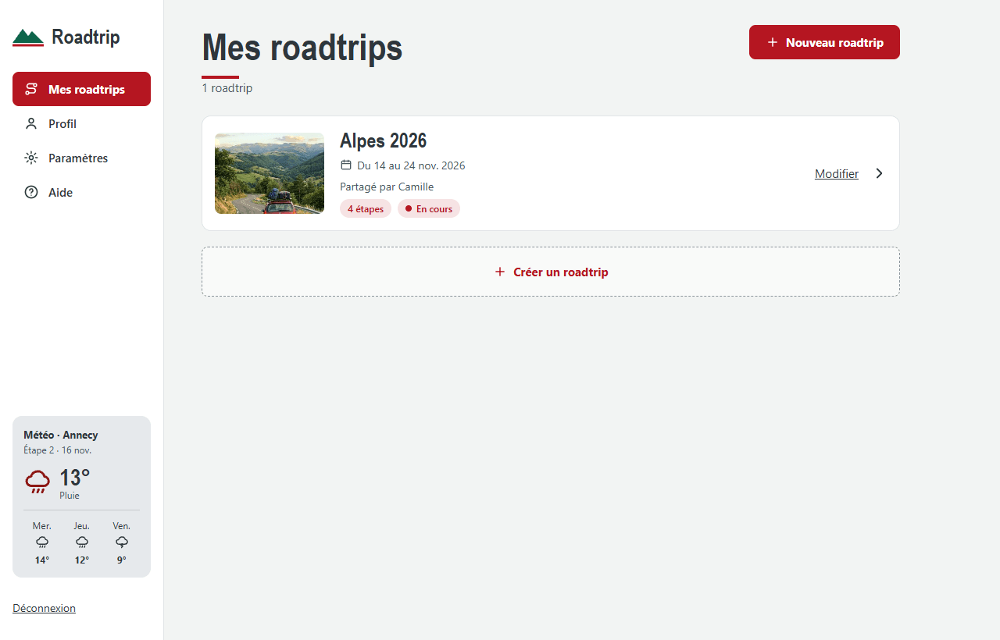

# Who can do what

Everyone with access to a road trip has one of these three roles.

| What the person can do | Owner (*Propriétaire*) | Can edit (*Peut modifier*) | Can view (*Peut regarder*) |
|---|:---:|:---:|:---:|
| See the stops, dates, accommodation and map | ✓ | ✓ | ✓ |
| Add, edit or delete stops | ✓ | ✓ | — |
| Add, edit or delete accommodation, mark as paid | ✓ | ✓ | — |
| Change the road trip's name and dates | ✓ | ✓ | — |
| Share the road trip and manage rights | ✓ | — | — |
| Delete the road trip | ✓ | — | — |

- The **owner** is the person who created the road trip. There is only one per road trip.
- **Can edit** suits a travel companion who plans with you.
- **Can view** suits someone who only wants to follow the trip.

A road trip shared with you shows « Partagé par *First name* » (*Shared by*) in your list:

{ .capture loading=lazy }

## What a « Can view » person sees

- In **Mes roadtrips** (*My road trips*), the road trip shows **« Partagé par *First name* »** (*Shared by*) and **Lecture seule** (*Read only*).
- The buttons to add, edit or delete do not appear.
- If they still open an edit page, the app takes them back to the road trip with the message: « Vous pouvez seulement consulter ce roadtrip. » (*You can only view this road trip.*)

!!! info "If your rights change"
    If the owner changes your right while you are working, the app shows « Vos droits sur ce roadtrip ont changé. » (*Your rights on this road trip have changed.*) Reload the page.
