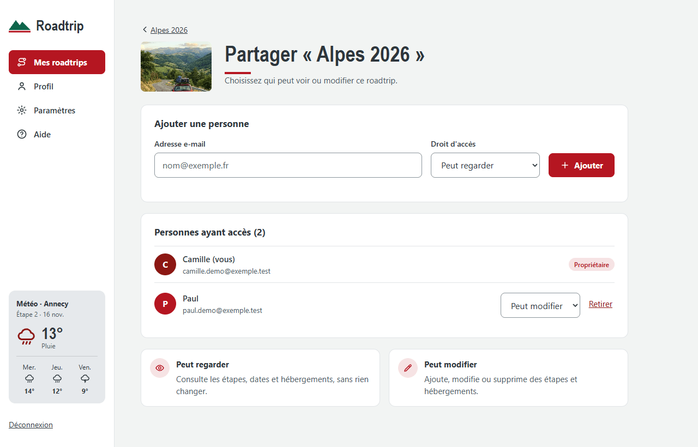

# Share a road trip

You can give the people travelling with you access to your road trip. They will see it in their own **Mes roadtrips** list (*My road trips*).

!!! warning "Before you start"
    - Only the road trip's **owner** can share it.
    - The person must **already have a Roadtrip account**. Ask them to [create one](../premiers-pas/creer-un-compte.md) with their email address. No invitation is sent by email.

## Add a person

{ .capture loading=lazy }

1. Open the road trip and click Partager (*Share*).
2. In **Ajouter une personne** (*Add a person*), enter their **email address**.
3. Choose their **access right**:
    - **Peut regarder** (*Can view*, the default): they see everything without changing anything;
    - **Peut modifier** (*Can edit*): they can add, edit or delete stops and accommodation.
4. Click Ajouter (*Add*).

The message « *First name* peut maintenant regarder « *name* ». » (*First name can now view « name ».*) confirms it.

## Possible messages

| Message | What to do |
|---|---|
| « Aucun compte RoadsPlanner avec cet e-mail. » (*No RoadsPlanner account with this email.*) | The person has no account yet, or uses another address. Ask them to sign up, then try again. |
| « *First name* a déjà accès à ce roadtrip. » (*already has access to this road trip.*) | Nothing to do: they are already in the list. |
| « Vous êtes déjà propriétaire de ce roadtrip. » (*You already own this road trip.*) | You entered your own address. |

## Change someone's right

In **Personnes ayant accès** (*People with access*), change the list next to their name (**Peut regarder** or **Peut modifier**).
The change is saved immediately.

## Remove access

1. Click **Retirer** (*Remove*) next to the person.
2. Confirm with Retirer l'accès (*Remove access*).

The person no longer sees the road trip.
