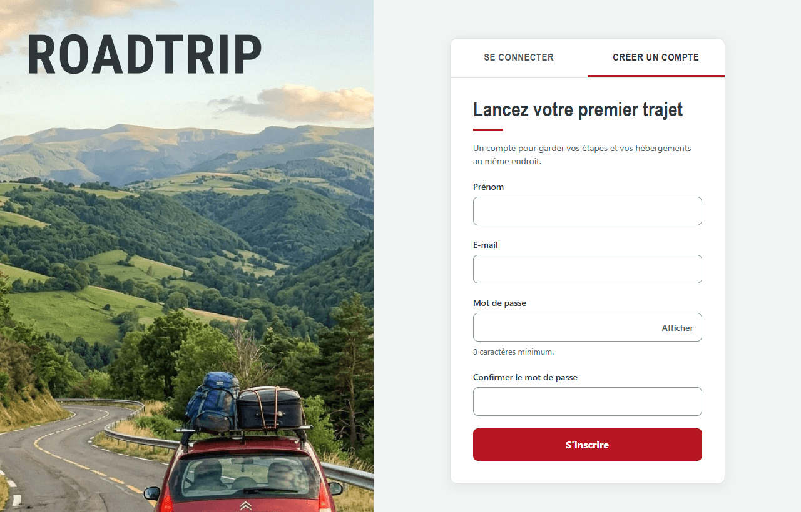

# Create an account

An account lets you find your road trips on any device and share them. It is free.

## Steps

1. Open the app. If you are not logged in, the login page appears.
2. At the top of the form, click the Créer un compte tab (*Create an account*).
   The title changes to **« Lancez votre premier trajet »** (*Start your first trip*).
3. Fill in the four fields:

    | Field | What to enter |
    |---|---|
    | **Prénom** (*First name*) | Your first name, as others will see it when you share a road trip (50 characters max). |
    | **E-mail** | Your email address, for example `name@example.com`. You use it to log in. |
    | **Mot de passe** (*Password*) | At least **8 characters**. The Afficher button (*Show*) lets you check what you typed. |
    | **Confirmer le mot de passe** (*Confirm password*) | The same password, a second time. |

4. Click S'inscrire (*Sign up*).

{ .capture loading=lazy }

You are logged in straight away and land on the **Mes roadtrips** page (*My road trips*), still empty. Next: [Create a road trip](../roadtrip/creer.md).

## If a red message appears

| Message | What to do |
|---|---|
| « Indiquez votre prénom. » (*Enter your first name.*) | The first name is required. |
| « Indiquez une adresse e-mail valide… » (*Enter a valid email address…*) | Check that the address contains an `@` and a dot. |
| « Le mot de passe doit contenir au moins 8 caractères. » (*The password must be at least 8 characters.*) | Make your password longer. |
| « Les deux mots de passe ne correspondent pas. » (*The two passwords don't match.*) | Type the same password in both fields. |
| « Un compte existe déjà avec cet e-mail. » (*An account already exists with this email.*) | You already have an account: click **Se connecter avec cet e-mail** (*Log in with this email*). |

Fields marked with a star **\*** are required. If something is missing, a banner at the top of the form tells you how many fields still need to be filled in.
