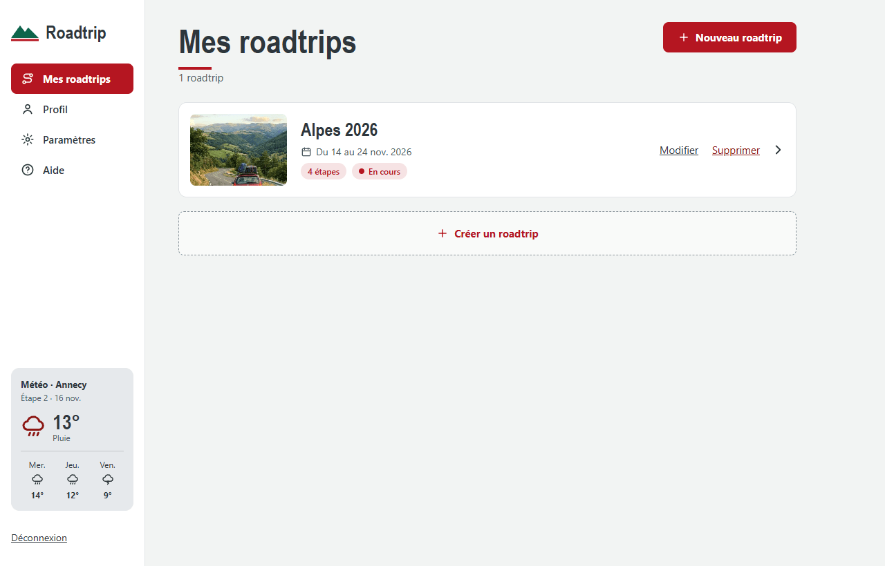
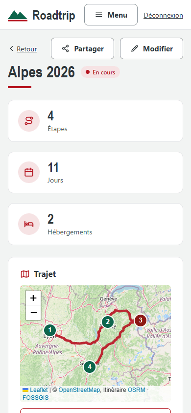

# Find your way around

Once you are logged in, the screen is always laid out the same way.

{ .capture loading=lazy }

## The left menu

| Item | What it is for |
|---|---|
| **Roadtrip logo** | Takes you back to the list of your road trips. |
| **Mes roadtrips** (*My road trips*) | The list of all your trips (yours and those shared with you). |
| **Profil**, **Paramètres**, **Aide** (*Profile, Settings, Help*) | Not available yet: these pages show « Bientôt disponible » (*Coming soon*). |
| **Weather card** | The weather at your current stop (see below). |
| **Déconnexion** (*Log out*) | Logs you out. |

!!! info "On a phone"
    On a small screen, the left menu is replaced by a compact header: the logo (which takes you back to your road trips) and the **Déconnexion** link. The content is shown in a single column.

    { .capture loading=lazy width="300" }

## The weather card

At the bottom of the menu, a small card shows **« Météo · *Town* »**: today's temperature and the next three days.

- The town is the one of the stop **under way today**, otherwise the **next** one, otherwise the **first** one.
- Inside a road trip, it is the weather for that road trip; elsewhere, for your first road trip.
- If none of your stops is placed on the map yet: « Ajoutez une étape pour voir la météo de votre destination. » (*Add a stop to see the weather at your destination.*)
- If the weather service does not answer: « Météo indisponible pour le moment. » (*Weather unavailable for now.*)

!!! tip "No weather for a town?"
    The weather is only available for stops whose town was **picked from the list of suggestions**. See [Add a stop](../roadtrip/ajouter-une-etape.md#the-town).

## The « Mes roadtrips » page

This is your home page. Each road trip appears as a card with:

- its **name** (click it to open the trip) and its **dates**, for example « Du 3 au 10 juil. 2026 » (*From 3 to 10 July 2026*);
- the **number of stops**;
- its **status**: *Brouillon* (*Draft*, no stop yet), *À venir* (*Upcoming*), *En cours* (*In progress*) or *Terminé* (*Finished*);
- « **Partagé par** *First name* » (*Shared by*) if someone shared it with you, and **Lecture seule** (*Read only*) if you can only view it;
- the **Modifier** (*Edit*) and **Supprimer** (*Delete*) links when you are allowed to use them.

Trips in progress and upcoming are at the top, finished trips at the bottom.

## Messages from the app

- A **green or grey message** at the top of the page confirms an action (« Roadtrip créé. » *Road trip created.*, « Étape ajoutée » *Stop added*…).
- A **red message** under a field explains what to correct.
- « **Chargement…** » (*Loading…*) appears while the information is arriving.
