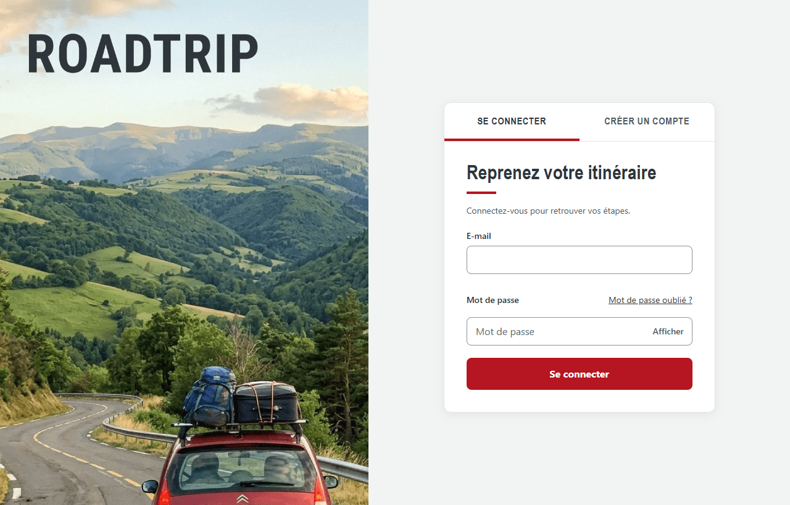

# Log in and log out

## Log in

1. Open the app: the page **« Reprenez votre itinéraire »** (*Pick up your route*) appears.
2. Enter your **E-mail** and your **Mot de passe** (*Password*).
3. Click Se connecter (*Log in*).

{ .capture loading=lazy }

You land on **Mes roadtrips** (*My road trips*). If you had opened a link to a specific page (for example a shared road trip), the app takes you back there after you log in.

### If something goes wrong

- **« E-mail ou mot de passe incorrect »** (*Wrong email or password*): check the address and the password (watch out for capital letters). The password field is emptied, type it again.
- **« Trop de tentatives. Réessayez dans 15 minutes. »** (*Too many attempts. Try again in 15 minutes.*): after 5 failed attempts, logging in is blocked for 15 minutes to protect your account. Wait, then try again.

!!! warning "Forgotten password"
    The **Mot de passe oublié ?** link (*Forgot your password?*) exists, but resetting is **not available yet**: the page says « Réinitialisation disponible dans une prochaine version. » (*Reset available in a future version.*) and no email is sent. Keep your password somewhere safe.

## Staying logged in

You stay logged in on this device. If your session expires, the app shows **« Votre session a expiré. Reconnectez-vous. »** (*Your session has expired. Log in again.*): just log in again.

## Log out

At the bottom of the left menu, click Déconnexion (*Log out*).
You return to the login page with the message **« Vous êtes déconnecté. »** (*You are logged out.*)

On a shared computer, remember to log out before you leave.
