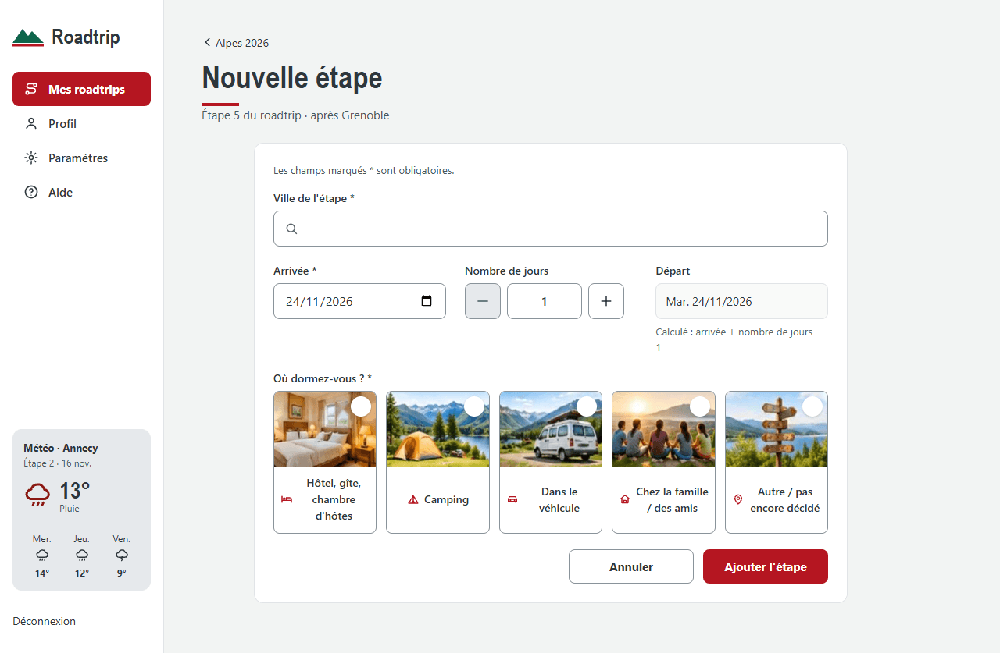

# Add a stop

A **stop** (*étape*) is a town where you stop: you arrive there on a given day and stay a number of days. Stops follow each other in date order.

## Steps

1. Open your road trip from **Mes roadtrips** (*My road trips*).
2. Click + Ajouter une étape (*Add a stop*).
   The subtitle reminds you where the stop goes: « Première étape du roadtrip » (*First stop of the road trip*) or « Étape 2 du roadtrip · après Lyon » (*Stop 2 of the road trip · after Lyon*).
3. Fill in the **Nouvelle étape** form (*New stop*, details below).
4. Click Ajouter l'étape (*Add the stop*)
   (or Continuer vers l'hébergement, *Continue to accommodation*, if you chose a hotel).

The message **« Étape ajoutée »** (*Stop added*) confirms it was saved.

{ .capture loading=lazy }

## The town

In **Ville de l'étape** (*Town of the stop*), type at least **3 letters**: a list of suggestions appears (5 towns at most, from OpenStreetMap).

It is best to pick a town from the list.

!!! warning "Why pick from the list?"
    You can also keep what you typed, for example if the town is not suggested (« Aucune suggestion : vous pouvez garder votre saisie. », *No suggestion: you can keep what you typed.*).
    But a town typed by hand **has no position**: the stop **will not appear on the map** and the **weather** will not be available for it.

The **✕** button clears what you typed.

## The dates

| Field | What to know |
|---|---|
| **Arrivée** (*Arrival*) | The day you arrive. It is pre-filled with the departure day of the previous stop. |
| **Nombre de jours** (*Number of days*) | How many days you stay (1 to 365). Use the **−** and **+** buttons. |
| **Départ** (*Departure*) | Calculated automatically: **arrival + number of days − 1**. |

!!! example "Example"
    Arrival on **16 October**, **3 days** → departure on **18 October**.
    With **1 day**, you leave on the same day you arrive.

The stop must stay **within the road trip's dates** and must not **overlap** another stop. Otherwise a message says so, for example: « Ces dates chevauchent l'étape 2 · Annecy (16–19 oct.). » (*These dates overlap stop 2 · Annecy.*)

## Où dormez-vous ? (Where are you sleeping?)

Choose one of the **5 cards**:

- Hôtel, gîte, chambre d'hôtes (*Hotel, holiday cottage, B&B*)
- Camping (*Campsite*)
- Dans le véhicule (*In the vehicle*)
- Chez la famille / des amis (*With family / friends*)
- Autre / pas encore décidé (*Other / not decided yet*)

Each choice asks for different information: everything is explained in [Choose where to sleep](hebergement.md).

## Leaving without saving

If you click Annuler (*Cancel*) after starting to fill in the form, the app asks **« Abandonner cette étape ? »** (*Discard this stop?*).
Abandonner (*Discard*) erases what you entered. Annuler (*Cancel*) lets you carry on.
