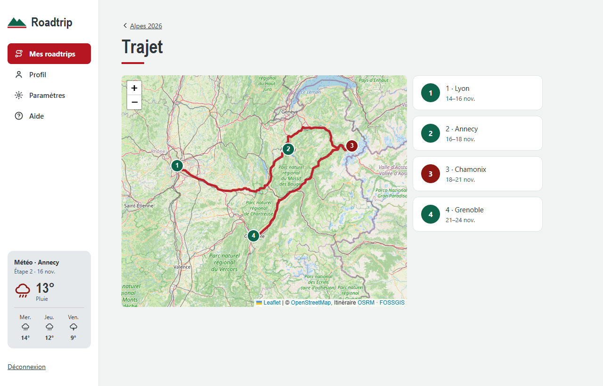

# See the route on the map

The **Trajet** page (*Route*) shows all your stops on a map, linked by the road.

## Open the map

You have two options:

- on the dashboard, click Voir sur la carte (*See on the map*);
- on a stop's page, click Voir sur la carte to centre the map on that stop.

## What you see

{ .capture loading=lazy }

- Each stop is a **numbered circle**, in trip order.
- The red line follows **the roads** between stops. While loading, or if the route service does not answer, stops are linked by straight lines.
- Click a circle to show **« Étape N · Town »** (*Stop N · Town*).
- Next to the map is the **list of stops** with their dates. Click a stop to centre the map on it.

To move around the map:

- use the **+** and **−** buttons or the mouse wheel to zoom;
- drag the map to move it.

## A stop is missing?

Under the map, a message may say for example: **« 1 étape sans position n'apparaît pas sur la carte : Pralognan. »** (*1 stop without a position does not appear on the map: Pralognan.*)

This happens when the town was **typed by hand** instead of being picked from the suggestions. To fix it:

1. open the stop and click Modifier (*Edit*);
2. clear the town and type it again;
3. **pick it from the list**;
4. save.

!!! info "Map unavailable"
    If the map background does not load (network problem), the app shows « Carte indisponible pour le moment. » (*Map unavailable for now.*) and lists your stops in order.

!!! note "Sources"
    Map background © OpenStreetMap. Route calculated by OSRM.
