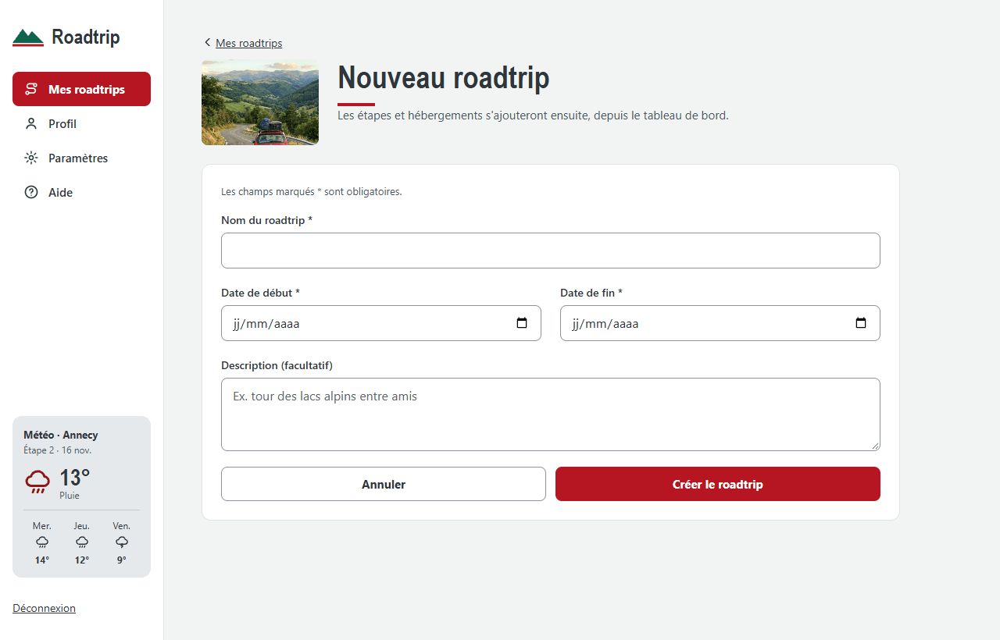

# Create a road trip

A **road trip** is your whole journey: a name, a start date and an end date. Stops and accommodation are added afterwards.

## Steps

1. On **Mes roadtrips** (*My road trips*), click + Nouveau roadtrip (*New road trip*)
   (or + Créer un roadtrip, *Create a road trip*, if the list is empty).
2. Fill in the **Nouveau roadtrip** form:

    | Field | Example | Rule |
    |---|---|---|
    | **Nom du roadtrip** (*Road trip name*) | Alpes 2026 | Required, 80 characters max. |
    | **Date de début** (*Start date*) | 14/10/2026 | Required. |
    | **Date de fin** (*End date*) | 22/10/2026 | Same day as the start date or later. 365 days max. |
    | **Description** | Autumn holidays with the family | Optional, 500 characters max. |

    As soon as both dates are filled in, the **length** is shown (for example « 9 jours », *9 days*).

    { .capture loading=lazy }

3. Click Créer le roadtrip (*Create the road trip*).

The message **« Roadtrip créé. »** (*Road trip created.*) appears and you land on the road trip's **dashboard**, still empty: **« Votre roadtrip est encore vide… »** (*Your road trip is still empty…*).

Next: [Add a stop](ajouter-une-etape.md).

!!! tip "Not sure of the dates yet?"
    Enter approximate dates: you can [change them later](modifier-supprimer.md).

## Possible messages

| Message | Meaning |
|---|---|
| « Donnez un nom à votre roadtrip. » (*Give your road trip a name.*) | The name is required. |
| « La date de fin doit être le même jour ou après la date de début. » (*The end date must be the same day as the start date or later.*) | The dates are the wrong way round. |
| « Un roadtrip dure au plus 365 jours. » (*A road trip lasts 365 days at most.*) | The trip is too long. |
