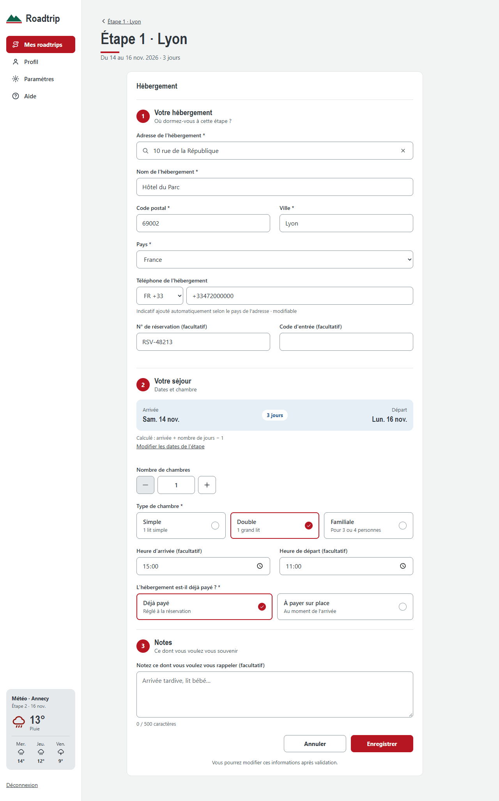
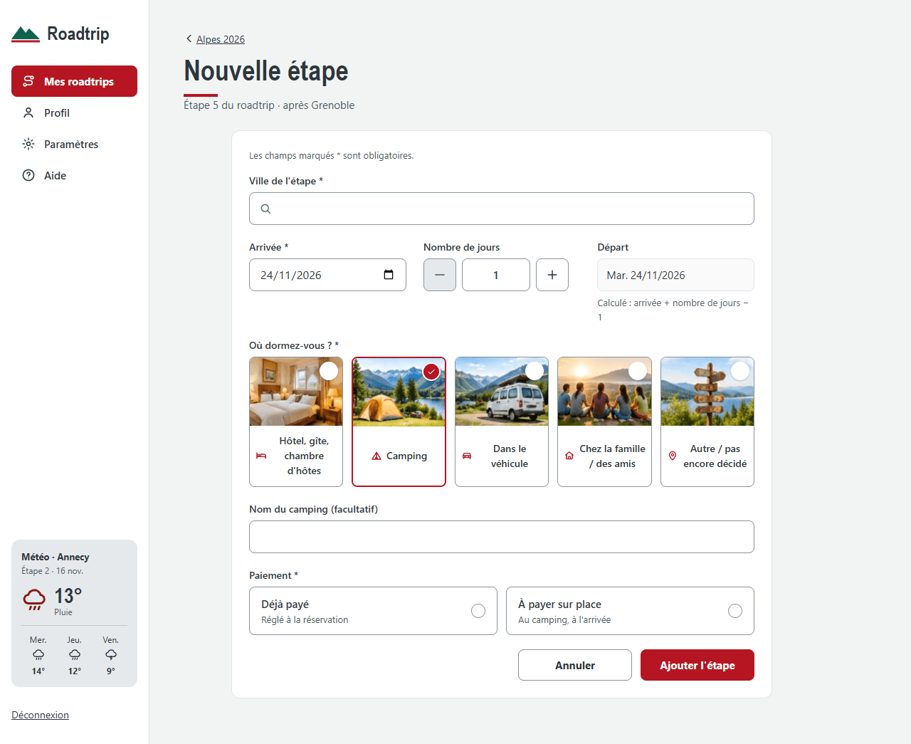

# Choose where to sleep

For each stop, you say where you sleep in **« Où dormez-vous ? »** (*Where are you sleeping?*). Each choice asks for different information.

## Hôtel, gîte, chambre d'hôtes (Hotel, holiday cottage, B&B)

This is booked accommodation. After choosing this card, click Continuer vers l'hébergement (*Continue to accommodation*): a second form, **Hébergement** (*Accommodation*), opens.

**Votre hébergement** (*Your accommodation*)

- **Adresse** (*Address*): type it, then pick a suggestion. The postcode, town and country fill in by themselves. If no suggestion appears (« Adresse introuvable », *Address not found*), fill in the fields yourself.
- **Nom de l'hébergement** (*Name*), **Code postal** (*Postcode*), **Ville** (*Town*), **Pays** (*Country*): required for a hotel.

**Votre séjour** (*Your stay*)

- The **dates** are those of the stop. To change them, use the **Modifier les dates de l'étape** link (*Change the stop's dates*).
- **Nombre de chambres** (*Number of rooms*, 1 to 10) and **Type de chambre** (*Room type*):
    - *Simple*: 1 single bed;
    - *Double*: 1 double bed;
    - *Familiale* (*Family*): for 3 or 4 people.
- **Heure d'arrivée** (*Check-in time*) and **Heure de départ** (*Check-out time*): optional.
- **Paiement** (*Payment*): choose **Déjà payé** (*Already paid*) or **À payer sur place** (*To pay on site*).
- **N° de réservation** (*Booking number*): optional.

**Vos coordonnées** (*Your contact details*)

- **Téléphone** (*Phone*): optional. Choose the country code first.

{ .capture loading=lazy }

Finish with Enregistrer l'hébergement (*Save accommodation*). The message « Hébergement enregistré. » (*Accommodation saved.*) appears.

!!! tip "Not booked yet?"
    Save the stop without filling in the accommodation. It will be flagged **« sans hébergement »** (*no accommodation*) on the dashboard, so you don't forget it.

## Camping (Campsite)

Directly in the stop form:

{ .capture loading=lazy }

- **Nom du camping** (*Campsite name*): optional.
- **Paiement** (*Payment*): choose **Déjà payé** (*Already paid*, paid when booking) or **À payer sur place** (*To pay on site*, on arrival). This choice is required.

You can add more details later from the stop's page with + Ajouter un hébergement (*Add accommodation*):

- address and phone;
- pitch: *Tente* (*Tent*), *Caravane* (*Caravan*), *Camping-car* (*Motorhome*) or *Van*;
- number of people (1 to 20).

## Dans le véhicule (In the vehicle)

Everything is optional:

- **Type de véhicule** (*Vehicle type*): Voiture (*Car*), Van aménagé (*Campervan*), Camping-car (*Motorhome*) or Autre (*Other*). Useful to know whether a motorhome area or a car park is enough.
- **Lieu prévu** (*Planned place*): for example « aire de camping-car du lac » (*lakeside motorhome area*).

## Chez la famille / des amis (With family / friends)

Everything is optional:

- **Chez qui ?** (*Staying with whom?*)
- **Adresse** (*Address*): with suggestions.

## Autre / pas encore décidé (Other / not decided yet)

No extra questions. The stop is flagged **without accommodation** until you choose another option.

## Paid or to pay?

For hotels and campsites, a **badge** on the stop shows where you stand:

- **Payé** (*Paid*): nothing to pay on site;
- **À payer** (*To pay*): you will pay when you arrive.

Once you have paid, open the stop and click Marquer comme payé (*Mark as paid*).

!!! info "No prices"
    The app only records whether it is **paid** or **to pay**. It does not store amounts.

## Changing your mind

If you change the option of a stop that already had accommodation (for example from hotel to campsite), the app warns you: **« Supprimer l'hébergement ? »** (*Delete the accommodation?*).
The previous accommodation is then deleted.
