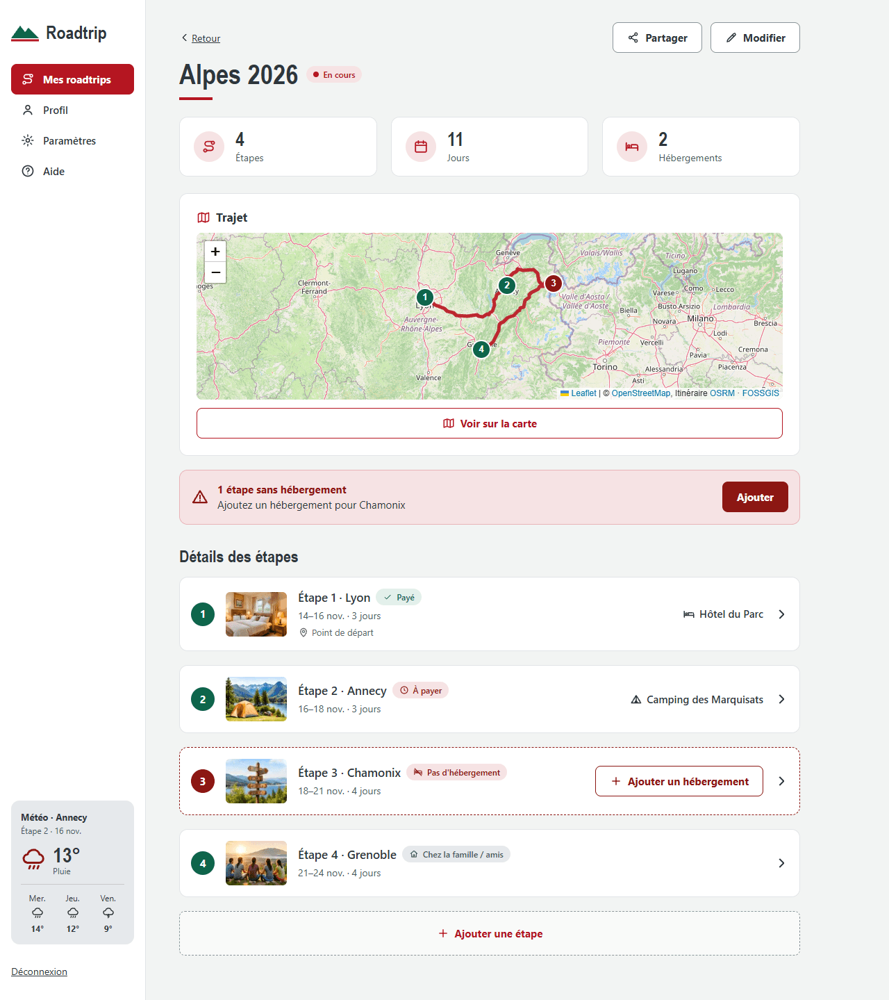
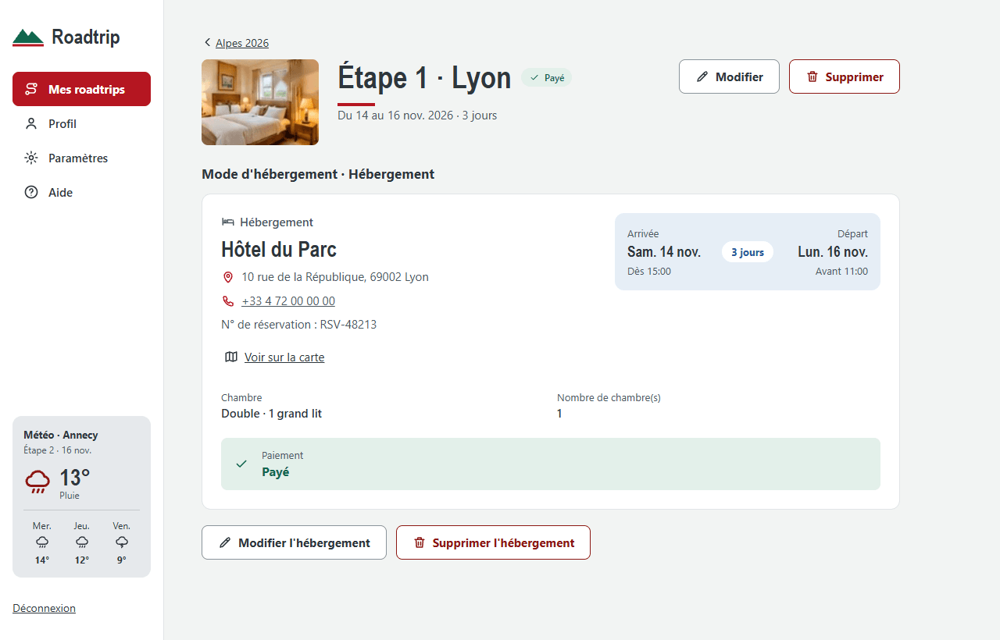
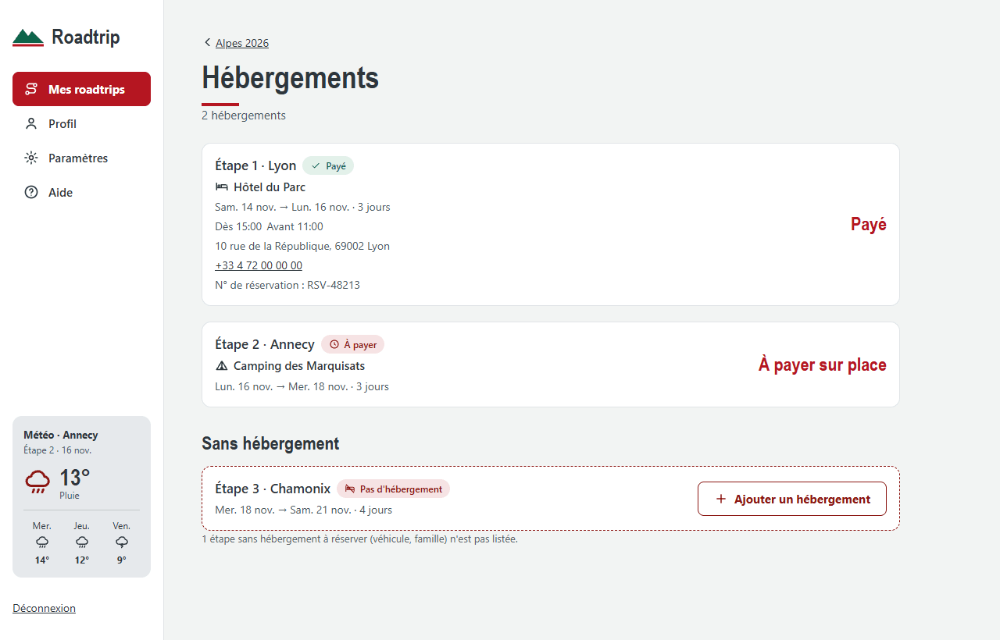

# Follow your road trip

When you open a road trip, you land on its **dashboard**. The whole trip is there.

{ .capture loading=lazy }

## At the top of the page

- The road trip's **name**, its **dates** and its **status**: *Brouillon* (*Draft*), *À venir* (*Upcoming*), *En cours* (*In progress*) or *Terminé* (*Finished*).
- The Partager button (*Share*), only visible to the owner. See [Share a road trip](../partage/partager.md).
- The Modifier button (*Edit*), to change the name or the dates.

## The figures

| Figure | Meaning |
|---|---|
| **Étapes** (*Stops*) | Number of towns on the trip. |
| **Jours** (*Days*) | Length of the road trip, from the start date to the end date. |
| **Hébergements** (*Accommodation*) | Number of hotels and campsites filled in. Click it to open the **accommodation list**. |

## The route

A small map shows your stops. Click Voir sur la carte (*See on the map*) to enlarge it. See [See the route on the map](carte.md).

## The « no accommodation » alert

If some stops have no accommodation yet, a box says so, for example: **« 2 étapes sans hébergement — Ajoutez un hébergement pour Lyon et Nice »** (*2 stops without accommodation — Add accommodation for Lyon and Nice*).

The Ajouter button (*Add*) takes you straight to the first stop to complete.

This concerns:

- stops set to « Autre / pas encore décidé » (*Other / not decided yet*);
- hotels and campsites whose accommodation is not filled in.

## Stop details

Each stop appears as a card, in trip order. It shows:

- **« Étape N · Town »** (*Stop N · Town*);
- the **dates** and the number of days;
- a **badge**: *Payé* (*Paid*), *À payer* (*To pay*), *Pas d'hébergement* (*No accommodation*), *Dans le véhicule* (*In the vehicle*) or *Chez la famille / amis* (*With family / friends*).

{ .capture loading=lazy }

The first stop is marked **Point de départ** (*Starting point*). Click a stop to see all its details: address, phone, times, booking number, payment.

At the bottom of the list, + Ajouter une étape (*Add a stop*) adds the next stop.

## The accommodation list

{ .capture loading=lazy }

Clicking the **Hébergements** figure gives you the list of all your hotels and campsites. For each one it shows:

- the **dates** and **times** (« Dès 15:00 », *From 15:00*; « Avant 11:00 », *Before 11:00*);
- the **address** and **phone** (tap to call on a phone);
- the **booking number**;
- the **payment** status.

Stops still **without accommodation** are grouped at the end.

« Vehicle » and « family » stops have nothing to book: they are not in this list.
